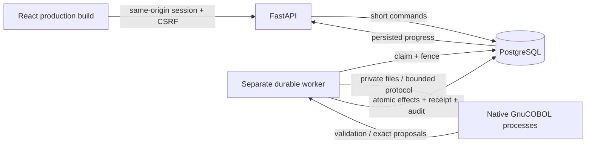
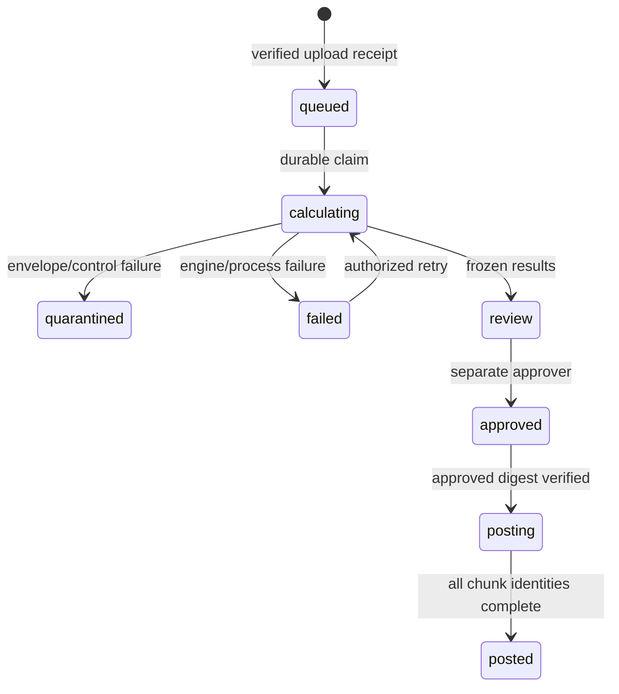

# Architecture and decisions



## State and transaction boundary



An intact file can contain rejected domain instructions. A quarantined envelope cannot be approved. Approval binds input SHA-256, policy, engine build, financial result digest and proposal digest. Database triggers protect frozen snapshots. Workers verify those values before posting the exact retained proposals.

```mermaid
sequenceDiagram
  participant W as Worker
  participant P as PostgreSQL
  W->>P: Claim job FOR UPDATE SKIP LOCKED
  P-->>W: New monotonic fence + lease
  W->>P: BEGIN; lock job and assert current fence
  W->>P: Lock records in source/reference order
  W->>P: Insert immutable journals; update record states
  W->>P: Insert chunk receipt; update progress; append audit
  W->>P: COMMIT all effects together
  W->>P: Acknowledge job completion
```

Failure before commit rolls back all chunk effects. Failure after commit leaves its receipt and journals together; recovery skips that chunk and finishes remaining work. A recovered claim increments its fence. A stale owner cannot acquire the protected job row with matching live ownership. `SKIP LOCKED` selects work only; financial totals use normal complete SQL reads.

## Consequential decisions

1. **Compiled subprocess boundary:** avoids sharing a concurrent libcob runtime with HTTP requests. Arguments are arrays, no shell interpolation; temporary directories are private, output and time are bounded, native hashes are checked. Linux resource limits protect subprocess file/CPU/address-space use. Missing/broken engines fail visibly.
2. **Database as durable coordinator:** jobs, attempts, receipts and audit survive process failure. No in-memory request queue owns financial work. Retry has a bounded automatic budget and a separate authorized retry command.
3. **One two-legged journal row:** equal debit/credit amounts are structural; PostgreSQL validates account pairs, amounts, states, references, approval and reversal links. Runtime permissions and triggers reject edits/deletion.
4. **Immutable source/reference snapshot:** replay uses the original engine, policy and duplicate-conflict snapshot. Current posted/settled state is excluded from the canonical financial digest. V2 comparison is an inspection job without posting effects.
5. **Ordered audit:** an advisory transaction lock serializes append order. SHA-256 links canonical UTF-8 JSON events to the previous hash. Sequence gaps after aborted transactions are acceptable; event order and predecessor linkage are verified.
6. **Same-origin local delivery:** static assets and API share one origin. All fonts are bundled. There is no outbound runtime telemetry. Cookie transport can be HTTP only for loopback; nonlocal configuration requires HTTPS + Secure cookies.
7. **Bounded scope:** CAD and CIR1 only; ASCII80/LF and the exact documented IBM-037 mixed fixture only. No claim of arbitrary host record compatibility.

## Exact precision

Legacy detail amounts are signed seven integer digits plus two fractional digits. Physical-detail trailer totals use thirteen integer digits plus cents and include domain-rejected amounts. COBOL uses packed fixed decimals and sized accumulators with size-error handling. API money is decimal text, PostgreSQL `NUMERIC(16,2)` has fourteen integer digits, and payable is additionally constrained to `(0,2500]`. Reconciliation amounts have exactly two fractional digits. Native overflow never becomes a zero payment.

## Replay and evidence

Content-addressed engine builds include sources, copybooks, executable hashes and compiler flags. Native startup retains all existing builds; Compose stages each image build into persistent local state before starting services. Do not prune an archive referenced by a run. Evidence carries original files, frozen results/reference state, journals, exceptions, audit/checkpoint, sources/build and executed reports. The independent ZIP verifier checks hashes, canonical financial digest and audit linkage. Backup archives are private because database account hashes and sessions are not suitable for public evidence.
